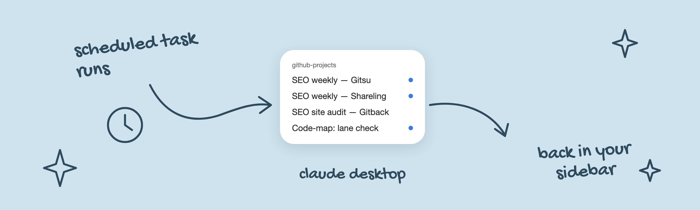
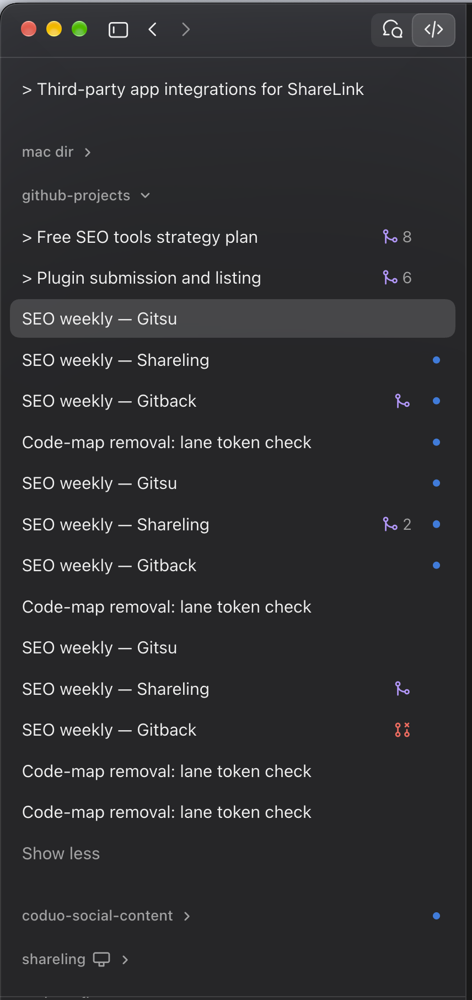

<p align="center"></p>

# claude-desktop-scheduled-tasks

Shows scheduled-task runs in the Claude desktop sidebar, as ordinary sessions with status dots, PR badges and Archive.

<p align="center"></p>

macOS only. Unofficial.

## Install

```sh
git clone https://github.com/sahildave/claude-desktop-scheduled-tasks
cd claude-desktop-scheduled-tasks
./install.sh
```

Quit Claude with Cmd+Q and open it again. To remove: `./uninstall.sh`, then restart Claude.

`install.sh` copies the extension into `~/Library/Application Support/Claude/extensions/` and installs a login item that sets `REACT_PROFILE=1`, which Claude needs to load extensions.

## How it works

The sidebar hides any session with a `scheduledTaskId`. The extension clears that field in the app's session store, so the app draws runs with its own rows. The Scheduled page is unaffected.

## Trade-offs

- The Scheduled entry's "needs attention" count no longer counts these runs.
- A Claude update can break it. Check for `[sched-sidebar]` lines in `~/Library/Logs/Claude/claude.ai-web.log`.

## License

MIT

---

<p align="center">
  <a href="https://www.coduo.co">
    <picture>
      <source media="(prefers-color-scheme: dark)" srcset="https://raw.githubusercontent.com/sahildave/coduo-skills/main/assets/apps/coduo-dark.svg">
      
    </picture>
  </a>
  <br>
  creating software<br>with intention
</p>

<p align="center">
  <a href="https://www.coduo.co"></a>&nbsp;&nbsp;
  <a href="https://gitsu.app"></a>&nbsp;&nbsp;
  <a href="https://gitback.us"></a>&nbsp;&nbsp;
  <a href="https://shareling.app"></a>&nbsp;&nbsp;
  <a href="https://www.coduo.co"></a>
</p>
